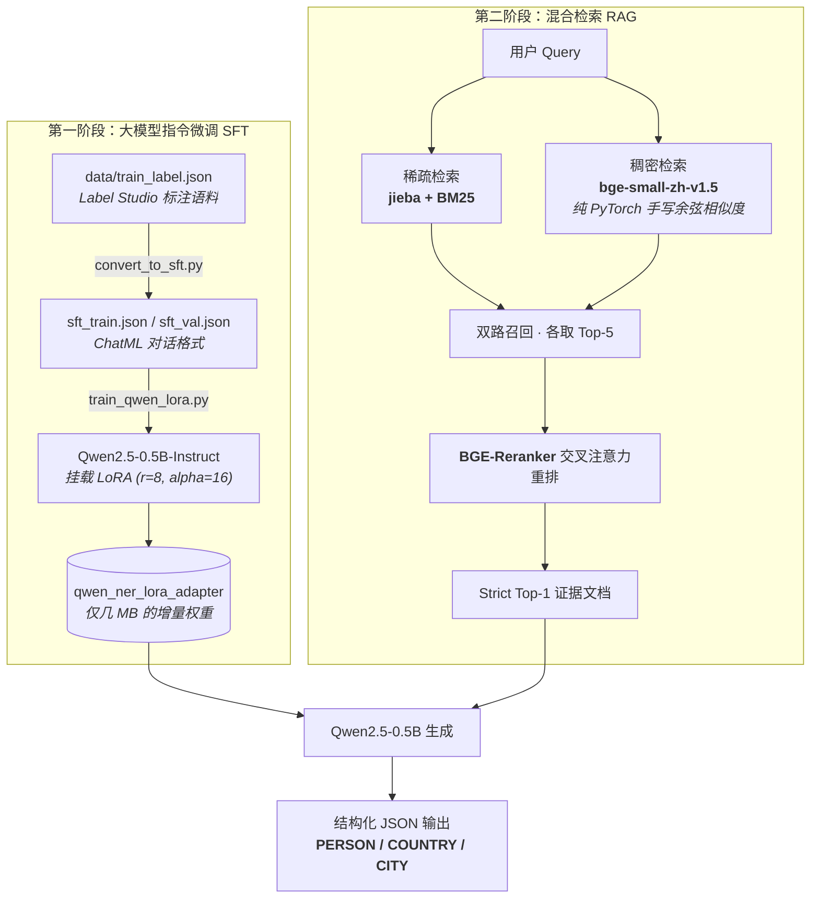

# Qwen-RAG-NER-Pipeline

基于大模型指令微调（SFT）与双路重排检索增强生成（RAG）的垂直领域问答系统。全流程不依赖 LangChain / LlamaIndex 等封装框架，检索核心以纯 PyTorch 实现，可在 RTX 3050 4GB 笔记本显卡上完整复现。

## 项目背景

现有 RAG 教程大多直接调用 LangChain 等黑盒框架，检索、重排、生成的内部过程不可见，也不利于面试时讲清原理。本项目以财经新闻专访的实体抽取（PERSON / COUNTRY / CITY）为任务，从零实现微调与检索全链路，并用消融实验量化每一步设计的收益。

## 核心设计

- **轻量化指令微调**：仅 32 条标注样本，通过 LoRA（r=8, alpha=16）微调 Qwen2.5-0.5B-Instruct，使其严格按 JSON 格式输出实体，解决小模型指令遵循能力弱的问题。
- **白盒向量检索**：`naive_rag.py` 手写文档向量化、余弦相似度矩阵计算与 Top-K 检索（`torch.nn.functional.cosine_similarity` + `torch.topk`），展示底层矩阵运算功底。
- **双路召回与交叉重排**：稀疏路用 `jieba` 分词 + BM25 捕获低频专有名词，稠密路用 `bge-small-zh-v1.5` 做语义匹配，再由 `bge-reranker-base` 交叉注意力统一打分，消除 RRF 融合的分数稀释。
- **抗上下文注意力劫持**：针对 0.5B 级模型在多文档输入下的 Context Distraction 缺陷，采用 Strict Top-1 证据窗口策略，端到端问答准确率达 100%。

## 系统架构



## 快速开始

运行环境：**Python 3.10+**，显存 4GB 以上。首次运行会自动下载 Qwen2.5-0.5B-Instruct、bge-small-zh-v1.5 与 bge-reranker-base 三个模型权重。

```bash
git clone https://github.com/carpool11/Qwen-RAG-NER-Pipeline.git
cd Qwen-RAG-NER-Pipeline
pip install -r requirements.txt
```

### 指令微调（SFT）

先将 Label Studio 标注数据转换为 ChatML 对话格式，再挂载 LoRA 微调：

```bash
python convert_to_sft.py      # 生成 data/sft_train.json 与 data/sft_val.json
python train_qwen_lora.py     # 输出 qwen_ner_lora_adapter/（已加入 .gitignore）
```

微调脚本内置 FP16 加载与显存保护，4GB 显存可直接运行；若仍不足，将 `per_device_train_batch_size` 调至 1 并开启 `gradient_accumulation_steps=2`。

### 检索与评测（RAG）

三个脚本按由浅入深排列，均在项目根目录直接运行：

```bash
python naive_rag.py           # 纯 PyTorch 手写向量检索，理解底层原理
python advanced_rag.py        # BM25 + 向量双路召回 + BGE-Reranker 重排
python evaluate_rag.py        # 4 组消融实验与端到端问答评测
```

## 评测结果

在自建垂直领域黄金评测集（含基础事实题、极低频专有名词题、语义改写题共 12 道）上进行消融实验。

| 检索策略 | Hit@1 | Hit@3 | MRR |
|:---|:---:|:---:|:---:|
| 1. BM25（仅稀疏检索） | 91.7% | 100.0% | 0.9583 |
| 2. BGE-Small（仅向量检索） | 91.7% | 100.0% | 0.9444 |
| 3. Hybrid RRF（双路融合，无重排） | 83.3% | 100.0% | 0.9167 |
| **4. Hybrid + Reranker（Ours）** | **100.0%** | **100.0%** | **1.0000** |

端到端问答准确率 `12/12 (100.0%)`，实测结果截图见 [assets/ablation_results.png](assets/ablation_results.png)。

## 实验洞察

1. **RRF 分数稀释现象**：小规模语料库中，简单使用 RRF 融合稀疏与稠密两路结果，Hit@1 反而从 91.7% 降至 83.3%。融合不等于变强，必须引入基于 Cross-Attention 的 Reranker 才能实现两路互补。
2. **生成上限依赖检索下限**：给 0.5B 模型同时输入含答案文档与高频干扰文档时，模型极易产生上下文偏置。将检索精度提升至 Hit@1 = 100% 后，改用 Strict Top-1 消除噪声，小模型抽取准确率达到完美表现。

## 运行环境

| 项目 | 配置 |
|:--|:--|
| GPU | NVIDIA RTX 3050 Laptop 4GB |
| 基座模型 | Qwen2.5-0.5B-Instruct |
| Embedding | BAAI/bge-small-zh-v1.5 |
| Reranker | BAAI/bge-reranker-base |
| 模型下载 | ModelScope 源（国内网络友好） |

## 目录结构

```text
Qwen-RAG-NER-Pipeline/
├── data/
│   ├── train_label.json           # 核心原始领域语料与 NER 标注（Label Studio 导出）
│   ├── sft_train.json             # 指令微调训练集（由 convert_to_sft.py 生成）
│   └── sft_val.json               # 指令微调验证集
├── convert_to_sft.py              # Label Studio 数据转 ChatML 对话格式
├── train_qwen_lora.py             # Qwen2.5-0.5B 加载、LoRA 挂载与微调训练
├── naive_rag.py                   # 纯 PyTorch 实现的极简稠密向量检索
├── advanced_rag.py                # BM25 稀疏 + 向量稠密 + Reranker 重排
├── evaluate_rag.py                # 4 组消融实验与端到端量化评测
├── assets/
│   └── ablation_results.png       # 消融实验实测结果截图
├── requirements.txt               # 项目依赖清单
└── .gitignore                     # 忽略模型权重、缓存与字节码
```

## 相关项目

前置项目（BERT-CRF 中文 NER 与三组消融实验，F1 92.68%）：[chinese-ner-bert-crf](https://github.com/carpool11/chinese-ner-bert-crf)

## 开源许可

本项目基于 [MIT License](LICENSE) 开源。依赖模型 Qwen2.5、BGE 系列版权归各自作者所有。
