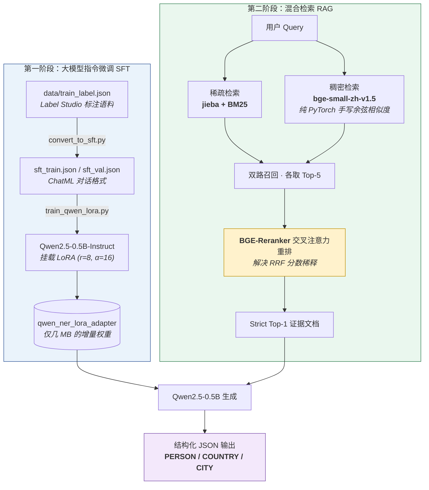
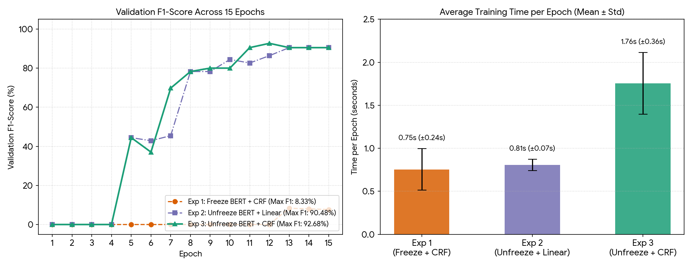

# Qwen-RAG-NER-Pipeline

🚀 **基于大模型指令微调（SFT）与双路重排检索增强生成（RAG）的高精度垂直领域问答系统**

> 在不依赖 LangChain / LlamaIndex 等高度封装框架的前提下，从零打通 **大语言模型微调 → 白盒向量检索 → 工业级双路重排 → 量化消融评测** 的完整链路。
> 全流程可在 **RTX 3050 4GB 笔记本显卡** 上复现。

---

## 🏗️ 系统架构图



---

## ✨ 核心亮点

| # | 亮点 | 说明 |
|:--|:--|:--|
| 1 | **轻量化指令微调** | 针对垂直领域（财经新闻专访）极小样本（32 条），用 LoRA 微调 Qwen2.5-0.5B，使其**严格遵循 JSON 格式**输出目标实体，解决小模型指令遵循能力弱的问题 |
| 2 | **白盒化底层 RAG** | 拒绝黑盒框架，`naive_rag.py` 中**纯手写 PyTorch 矩阵乘法**完成向量化、余弦相似度计算与 Top-K 检索（`torch.nn.functional.cosine_similarity` + `torch.topk`） |
| 3 | **工业级双路召回 + 交叉重排** | 稀疏路：`jieba + BM25` 捕获低频专有名词与长尾数字；稠密路：`bge-small-zh-v1.5` 捕获深层语义；最终由 `bge-reranker-base` 交叉注意力打分融合 |
| 4 | **抗上下文注意力劫持** | 针对 0.5B 极小模型在 RAG 场景下的 *Context Distraction* 缺陷，用「高精度重排 + Strict Top-1」控制输入窗口，端到端问答准确率提升至 **100%** |

---

## 📂 仓库结构

```text
Qwen-RAG-NER-Pipeline/
├── data/                          # 数据目录
│   ├── train_label.json           # 核心原始领域语料与 NER 标注（Label Studio 导出）
│   ├── sft_train.json             # 由 convert_to_sft.py 生成的指令微调训练集
│   └── sft_val.json               # 指令微调验证集
│
├── convert_to_sft.py              # 【SFT ①】Label Studio 数据 → ChatML 对话格式
├── train_qwen_lora.py             # 【SFT ②】Qwen2.5-0.5B 加载 + LoRA 挂载 + 微调训练
│
├── naive_rag.py                   # 【RAG ①】纯 PyTorch 手撕的极简稠密向量检索
├── advanced_rag.py                # 【RAG ②】BM25 稀疏 + 向量稠密 + BGE-Reranker 重排
├── evaluate_rag.py                # 【RAG ③】4 组消融实验与端到端量化评测
│
├── assets/
│   └── ablation_results.png       # 消融实验实测结果截图
├── requirements.txt               # 项目依赖清单
├── .gitignore                     # 忽略模型权重 / 缓存 / 字节码
└── README.md
```

---

## 🚀 快速开始

### 0. 环境准备

```bash
git clone https://github.com/carpool11/Qwen-RAG-NER-Pipeline.git
cd Qwen-RAG-NER-Pipeline
pip install -r requirements.txt
```

> 首次运行会自动下载 `Qwen2.5-0.5B-Instruct`、`bge-small-zh-v1.5`、`bge-reranker-base`（建议通过 ModelScope 源下载）。

### 1️⃣ 第一阶段：大模型指令微调（SFT）

```bash
# ① 将 Label Studio 标注数据洗成 ChatML 对话格式
python convert_to_sft.py          # → data/sft_train.json, data/sft_val.json

# ② 挂载 LoRA 微调 Qwen2.5-0.5B（含显存保护与 FP16 加载）
python train_qwen_lora.py         # → qwen_ner_lora_adapter/（已被 .gitignore 忽略）
```

### 2️⃣ 第二阶段：检索增强生成（RAG）

```bash
# ① 极简版：纯 PyTorch 手写的向量检索（理解底层原理）
python naive_rag.py

# ② 进阶版：BM25 稀疏 + 向量稠密 双路召回 + BGE-Reranker 重排
python advanced_rag.py

# ③ 4 组消融实验 + 端到端问答量化评测
python evaluate_rag.py
```

---

## 📊 核心量化评估（Ablation Study）

在自建的垂直领域**黄金评测集**（含基础事实题、极低频专有名词题、语义改写题共 **12 道**）上进行严格消融实验。

### 检索策略消融对比表

| 检索策略 (Strategy) | Hit@1 | Hit@3 | MRR (平均倒数排名) |
|:---|:---:|:---:|:---:|
| 1. BM25（仅稀疏检索） | 91.7% | 100.0% | 0.9583 |
| 2. BGE-Small（仅向量检索） | 91.7% | 100.0% | 0.9444 |
| 3. Hybrid RRF（双路融合，**无重排**） | 83.3% | 100.0% | 0.9167 |
| **4. Hybrid + Reranker（Ours）** | **100.0%** | **100.0%** | **1.0000** |

### 端到端问答准确率

```
12 / 12  →  100.0%
```



---

## 💡 实验洞察（Technical Insights）

1. **RRF 分数稀释现象**
   在小规模语料库中，简单地用 RRF（Reciprocal Rank Fusion）融合稀疏与稠密两路结果，**反而导致 Hit@1 从 91.7% 下降到 83.3%**。
   结论：融合不等于变强，必须引入基于 Cross-Attention 的 Reranker 才能实现「强强联合」。

2. **生成上限依赖检索下限**
   给 0.5B 小模型同时喂入「含答案的文档 + 高频干扰文档」的 Top-2 结果时，模型极易产生**上下文偏置（Context Distraction）**。
   在将检索精度提升至 Hit@1 = 100% 后，改用 **Strict Top-1** 策略消除噪声，小模型抽取准确率达到完美表现。

---

## 🖥️ 硬件与运行环境

| 项目 | 配置 |
|:--|:--|
| GPU | NVIDIA RTX 3050 Laptop **4GB** |
| 显存优化 | FP16 加载 + LoRA（r=8）+ 梯度检查点 |
| 基座模型 | Qwen2.5-0.5B-Instruct |
| Embedding | BAAI/bge-small-zh-v1.5 |
| Reranker | BAAI/bge-reranker-base |

> 显存不足时，可将 `train_qwen_lora.py` 中的 `per_device_train_batch_size` 调至 1，并开启 `gradient_accumulation_steps=2`。

---

## 📌 相关项目

- 前置项目（BERT-CRF 中文 NER 与消融实验）：[chinese-ner-bert-crf](https://github.com/carpool11/chinese-ner-bert-crf)

## 📄 License

本项目基于 MIT License 开源，详见 [LICENSE](LICENSE)。
